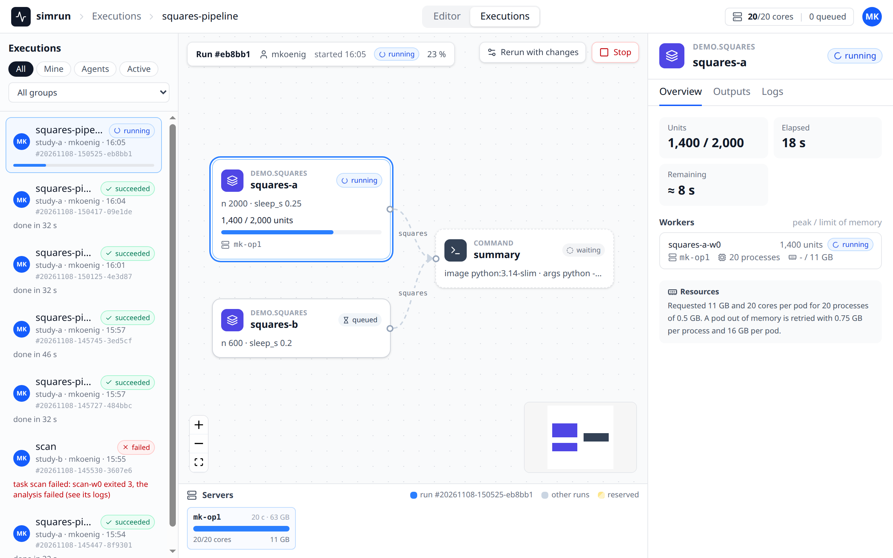
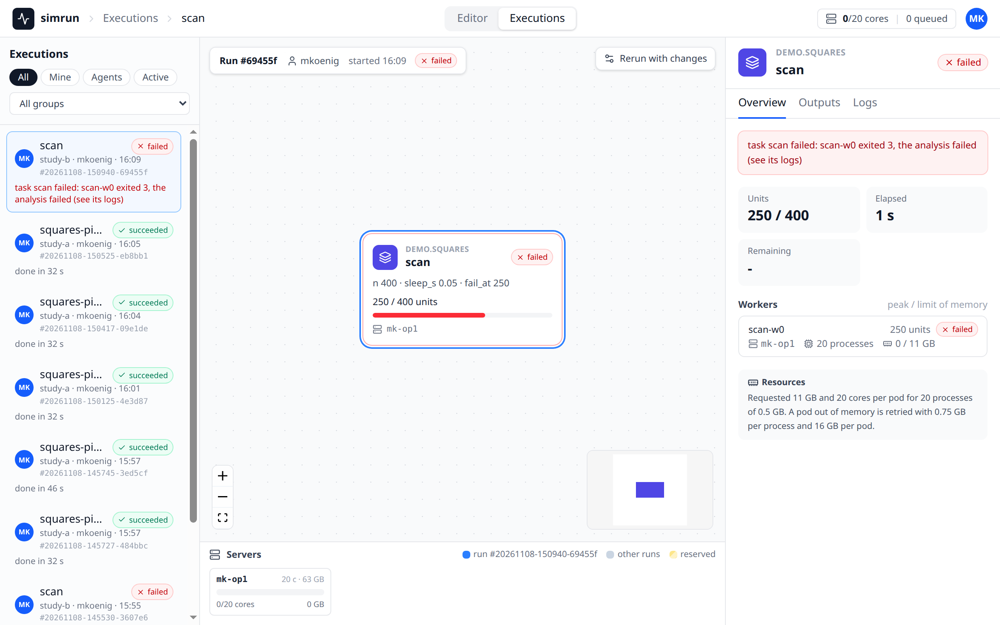
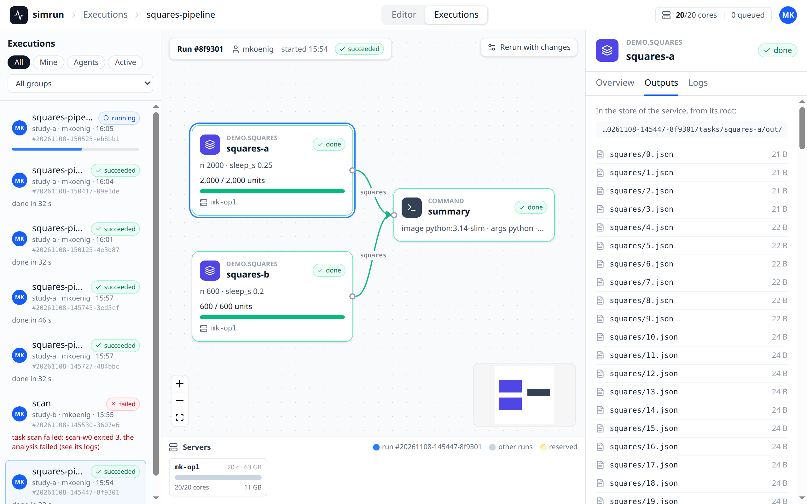
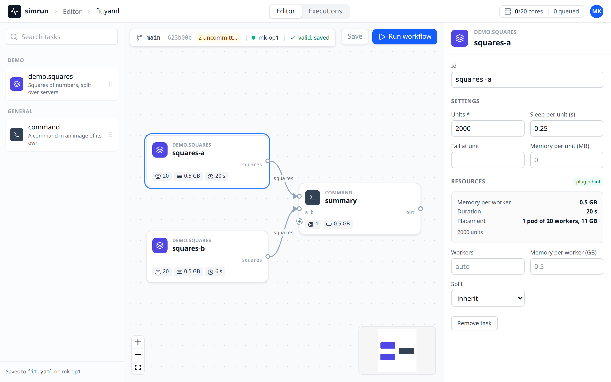

# Web app

The service serves a web app at `/ui/`, e.g. `http://localhost:8000/ui/` on the [local test system](testing.md#a-local-test-system), or on the [local service](local.md) of a project, which needs no cluster. It has two modes, switched in its top bar: the **Executions**, the runs of people and agents live, and the **Editor**, in which a workflow is built or changed, estimated and run while its file stays next to the code. The app talks only to the API of the service, with the token of the user; the service serves it from the directory of its setting `web` (`/opt/simrun/web` in the [service image](deployment.md#the-service-image)), and without that setting there is no `/ui/`.

## Login

The app asks for a token of the tokens file of the service (see [Authentication](service.md#authentication)), checks it with `GET /me` and keeps it in the local storage of the browser. Every request and every event stream sends it as a bearer token, never in a URL. A token the service no longer accepts (removed from the tokens file) returns the app to the login and removes the token from the browser.

## Executions

The view has the runs on the left, the canvas of the selected run in the center with the run bar above it and the servers below it, and the inspector on the right.

 Everything is live: the app reads the event streams `GET /events` (the runs and the servers) and `GET /runs/{run}/events` (the record, the progress and the workers of the selected run). When a stream drops, e.g. while the service restarts, the top bar shows **reconnecting** and the app connects again, waiting 1 s, doubling up to 10 s, and keeps the selected run.

- **Top bar**: where you are (the workflow of the selected run), the capacity of the cluster (the cores the pods of all servers request out of all cores, and the number of queued runs) and the identity of the token.
- **Runs**: a card per run, the 200 most recent, with the workflow, the run, who submitted it (an agent with its owner), its state, its progress and, for a failed run, its message. The chips **All**, **Mine** (the runs of the person of the token and of the person's agents), **Agents** and **Active** (submitting, queued or running) filter them, a menu selects a group. A click selects the run; the address `/ui/#/runs/<run>` keeps it on a reload.
- **Run bar**: the run, who submitted it and when, its state and its progress (tasks done, units done of all units), and **Stop**, which cancels a run that is not over after a confirmation in the bar.
- **Canvas**: a card per task, in columns by the depth of the task in the graph of its inputs, with the edges of the inputs. A card shows the type, the task, its state, its settings, the units of its ledger with a progress bar and the workers of a split task on their servers; a task split over several workers is drawn as a stack. A task without a ledger shows its state without a progress bar.
- **Servers**: a tile per server of the cluster with the cores and memory the pods of runs on it request, out of what the scheduler gives them (the allocatable cores and memory less the requests of other pods, e.g. of DaemonSets), a segment per pod, those of the selected run in blue; a reserved server says by which run.
- **Inspector**: without a selected task, the run: its message, who submitted it with which priority and when, its kills for memory and its sources (the snapshots with branch, commit and changed files). With a task selected on the canvas, the tabs **Overview** (why a failed task failed, the exit of its last pod; the units, the elapsed and the remaining time, or the phase, `starting` or `merging`; the numeric fields of the last progress line, the workers with their servers, processes and memory, and the resources its plan requested), **Outputs** (the output files of the task) and **Logs** (the last lines of every pod, read again every 5 s while the task runs; tracebacks and errors in red, the lines of the Argo executor hidden unless asked for). A server is named by the last two parts of its host name everywhere, `agent-0` for `k3d-simrun-test-agent-0`, the full name in a tooltip.





## The Editor { #the-editor }

The Editor edits a workflow file which stays on the machine with the code: the browser never reads or writes that machine, a command running there does. The browser can be on any machine which reaches the service.

### The command

On the machine with the working trees, with `SIMRUN_URL`, `SIMRUN_TOKEN` and `SIMRUN_STORE` set as for every [command](command-line.md) and the store mounted:

```bash
simrun edit fit.yaml --source model=~/git/pkdb_models --source sbmlsim=~/git/sbmlsim
```

It reads the file (a file which does not exist yet is a new workflow named by the file stem, without tasks), snapshots the sources, opens an edit session in the service and prints the link of the Editor, e.g. `http://localhost:8000/ui/#/edit/<id>`. It keeps running: it answers the saves and runs of the browser, and every 2 s it sends the file and the state of the working trees (branch, commit, uncommitted files) to the session when they changed. While a run is being submitted (plans, snapshots) it keeps telling the service that it is alive, and when the service is not reachable or a proxy answers 502, 503 or 504 (e.g. during a redeploy), it retries with a backoff of 1 s doubling to 10 s; a request is done once, also when its answer had to be sent again. Ctrl-C (or SIGTERM) closes the session and ends the command with exit code 0; when the service does not answer the close within 5 s, the command ends anyway and the session shows not connected after 30 s. A second Ctrl-C ends the command at once. `--group` is the group of the runs started from the Editor which name none.

### The session

A session lives in the store under `edits/<id>/`, so a restart of the service keeps it. The page `#/edit` (the **Editor** switch of the top bar) lists the sessions of your token by file name, with the directory, the machine, the workflow and whether the session is connected; the sessions which are no longer connected are listed under **Closed**, the ones not seen for a day behind **Show older**. A click opens one; the breadcrumb of the top bar then names the file. Saves and runs of a session are allowed only to the person whose token opened it. A session is **connected** while its command runs and asked the service for requests within the last 30 s.

### Editing

The Editor has the palette of the task types of the service on the left, the canvas in the middle with the bar floating above it, and the inspector on the right.



- **Palette**: the task types installed in the service, grouped by the part of their name before the first `.` (`demo.squares` under "Demo", `command` under "General"), with the `description` of the type (see [Plugins](plugins.md#the-contract)) and a search; its footer says which file a save writes on which machine. A click adds a task right of the right-most one and pans the canvas to show it, a drag drops it where it is let go. A new task is named by the last part of its type, with `-2`, `-3` for further ones.
- **Canvas**: a card per task with a handle per output port on the right and per input port of its type on the left; a `command` has a handle per input it reads and a `+`, where a connection adds an input named after the task it reads. Dragging from an output to an input connects them; a connection which closes a cycle or reaches a port which is already connected is refused with a note under the bar. Delete or Backspace removes the selected task (and the inputs which read it) or edge. The tasks are laid out when the session opens and when the workflow comes from disk; afterwards they stay where they are dragged. Positions are not saved in the file.
- **Inspector**: with a task selected, its type and id, its settings as a form of the JSON Schema of the settings of its type (numbers, choices and switches in two columns; an empty field is not written, so the default of the type applies; what the form cannot edit is edited as JSON), its inputs and the ports staged to local scratch, its resources (workers and memory per worker overriding the learned ones, its split; a `command` has the resources of its settings and stages nothing) and the estimate: memory per worker of the plan, duration and placement (the pods, the worker processes of a pod and the memory of a pod). Without a selected task, the workflow: its name, its split, the reservation of a server, the group of the run and the sources.
- **Validation and estimate**: every change is validated by the service 400 ms after the last one; the errors of a task show on its card and in the inspector, an error of a setting under its field, the others in the inspector of the workflow. A valid workflow is estimated with the last snapshots of the sources, and the cards show the chips of the estimate (workers, memory per worker, duration, pods). The estimate is of the workflow as edited: a task type which plans its settings does so only when the workflow runs.


### Save and Run

The bar shows the branch, the commit and the uncommitted files of the model source, the machine of the session and the state of the draft: **valid, saved**, **unsaved changes**, the number of errors, or **changed on disk**.

- **Save** sends the draft to the command, which writes it into the file atomically, in the form `simrun` writes a workflow (the fields which differ from the defaults, a list indented below its key): comments and the formatting of a hand-written file are not kept. Save is enabled only with unsaved changes (or a file changed on disk), so opening a hand-written file and looking at it never rewrites it. A save or a run waits up to 60 s for the command; it fails at once when the command stops meanwhile.
- **Run workflow** sends the draft, saved or not, to the command, which snapshots the working trees again, plans the tasks with the task types installed there and submits the run, as `simrun submit` does with the same sources. The file is not written by a run. The Editor then shows the run in the Executions.

### Conflicts

A change of the file on disk (by another editor, or by `git checkout`) reaches the Editor within a few seconds. Without unsaved changes the Editor takes the new workflow and lays it out again. With unsaved changes the bar says **changed on disk** and offers **Reload** (drop the draft for the file on disk) and **Save anyway** (overwrite the file on disk with the draft, whatever changed there). A plain Save is never written over a file which changed since the draft started from it: the command refuses it and the bar offers the same two choices. A file which appears on disk after the session opened on a missing file is such a change as well.

### Without a connected machine

When the command stopped, or its machine has not asked for 30 s (asleep, off the network), the bar says that the machine is **not connected**. **Save** becomes **Download YAML**, which downloads the draft as `<workflow name>.yaml` in the form a save writes, and the state says **unsaved changes, download to keep them** once the draft was changed. **Run workflow** submits the draft from the browser with the last snapshots of the session, as edited, without the plans of the task types. Starting the command again opens a new session.

**Rerun with changes** in the run bar of the Executions opens the workflow and the sources of a run in the Editor (`#/runs/<run>/edit`). There is no machine behind it, the bar says **from run #<run>**: Download YAML keeps the changes, and Run workflow submits the changed workflow with the snapshots, the group and the reservation of the run (the reservation shows in the inspector of the workflow and can be changed there).

## Development

The app is a Vite project in `frontend/` (Vue 3, TypeScript, Vue Flow, Tailwind CSS) with node 24 and the versions of `frontend/package-lock.json`:

```bash
cd frontend
npm ci                 # the dependencies of the lock
npm run dev            # the dev server at http://localhost:5173/ui/, with reload on every change
npm test               # the tests (Vitest, jsdom)
npm run typecheck      # vue-tsc
npm run build          # into frontend/dist, which the service serves with `web: frontend/dist`
```

The dev server proxies the API to the service of `SIMRUN_URL`, else `http://localhost:8000`, so it runs against the service of the [local test system](testing.md#a-local-test-system): start the service as described there, submit a run or start `simrun edit`, and open `http://localhost:5173/ui/` with the token `t-mk`. The service of the local test system also serves the built app at `http://localhost:8000/ui/` once `npm run build` made `frontend/dist`.

The types of the API in `frontend/src/api/schema.d.ts` are generated from the OpenAPI document of the service. After a change of the API:

```bash
uv run python scripts/openapi.py   # frontend/src/api/openapi.json, which a test keeps equal to the API
cd frontend && npm run types       # frontend/src/api/schema.d.ts
```

`frontend/mockup/` is the approved mockup the app is built from, a single page with data in memory.
